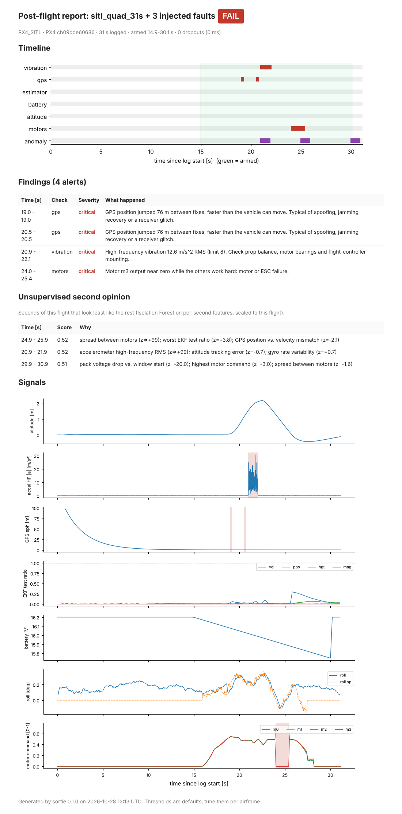

# Sortie

**Post-flight forensics for PX4 drone logs. Every check comes with a measured detection rate.**

After a test flight, someone has to open the log and work out whether anything went wrong:
a GPS glitch, a motor that stopped pulling, vibration from a chipped prop, a battery sagging under
load. Plotting tools show you the data, but you still have to know where to look. Sortie reads a
PX4 `.ulg` log, runs a set of rule checks plus an unsupervised second opinion, and writes a
one-page report with the exact time window to inspect.

The part I cared most about: **how do you know a check works?** Real crash logs with labelled
faults are rare, so Sortie ships a fault-injection benchmark. It takes real flights, injects
known faults at random times and magnitudes, and measures recall, latency and false alarms for
every check. The numbers below come from running that benchmark on the bundled logs.



*A real 31 s quadrotor flight with three injected faults (76 m GPS jump, vibration burst,
motor m3 dying). All three are found with the right time window. The Isolation Forest layer
independently ranks the motor and vibration seconds as the most unusual in the flight.*

---

## What it does

```
$ sortie analyze data/samples/cubeorange_vtol_6s.ulg
cubeorange_vtol_6s  [REVIEW]  CUBEPILOT_CUBEORANGE  7 s logged, armed -0.1-5.5 s
   !     0.2s  gps        GPS horizontal accuracy degraded to 3.3 m (EKF2_REQ_EPH default 3 m). Possible interference, multipath or antenna issue.
  ~~     2.9s  anomaly    score 0.54: pack voltage drop vs. window start (z=+3.3); attitude tracking error (z=+1.5); spread between motors (z=+1.2)
```

| Layer | What it looks at |
|---|---|
| **Vibration** | High-frequency accelerometer RMS and accelerometer clipping. Says "not assessable" when the log rate is too low, instead of passing silently |
| **GPS** | Horizontal accuracy (`EKF2_REQ_EPH`), satellite count (`EKF2_REQ_NSATS`), fix loss, and position jumps faster than the vehicle can move |
| **Estimator** | EKF2 innovation test ratios above 1.0, which means a sensor was rejected |
| **Battery** | Cell voltage under load, plus voltage sag that the current draw does not explain (fits `V = V0 - R*I` and flags residuals) |
| **Attitude** | Tracking error between attitude setpoint and estimate, only while airborne |
| **Motors** | Saturation, a dead motor while the others work hard, and imbalance in hover (CG offset, bent prop) |
| **Anomaly** | Isolation Forest over per-second features, scaled by the flight's own median and MAD, with the top deviating features as the explanation |

Output formats: terminal summary, JSON (`--json`), a self-contained HTML report (`--html`),
a SQLite fleet store (`sortie fleet`) and an HTTP API (`sortie serve`).

## Benchmark: does it actually catch things?

`sortie bench data/samples` runs every applicable fault type 25 times per flight on the five
bundled real logs. Faults get a random onset, duration and magnitude (seed 7). A trial counts
as detected when the expected check reports a finding overlapping the injected window. "Other
false alarms" counts new alerts from *other* checks that the clean flight did not have.

| Injected fault | Expected check | Trials | Detected | Median latency | Other false alarms / trial |
|---|---|---:|---:|---:|---:|
| EKF measurement rejection | estimator | 125 | 100% | 0.02 s | 0.00 |
| GPS position jump | gps | 43 | 100% | 0.03 s | 0.00 |
| GPS accuracy degradation | gps | 49 | 100% | 0.00 s | 0.00 |
| Vibration burst | vibration | 50 | 100% | 0.00 s | 0.00 |
| Battery sag | battery | 50 | **72%** | 0.48 s | 0.00 |
| Motor failure | motors | 50 | 100% | 0.06 s | 0.00 |
| Motor saturation | motors | 50 | 100% | 0.05 s | 0.00 |
| Attitude divergence | attitude | 25 | 92% | 0.30 s | 0.00 |
| *Control load step (healthy)* | *nothing* | 50 | *0% flagged* | n/a | 0.00 |
| *Tracked manoeuvre (healthy)* | *nothing* | 25 | *0% flagged* | n/a | 0.00 |

The two italic rows are **negative controls**: aggressive but healthy behaviour that a naive
threshold would flag. Sortie flags neither.

**Sensitivity.** The smallest fault each check finds in at least half of the trials:

| Fault | Detected at |
|---|---:|
| GPS jump | 12.7 m |
| GPS accuracy | 3.5 m eph |
| Vibration | 4.7 m/s² noise σ |
| Battery sag | 0.34 V per cell |
| Attitude error | 11° |
| EKF test ratio | 1.04 |

**Unsupervised layer.** How often the injected fault lands in the 3 seconds the Isolation Forest
ranks as most anomalous, compared with picking 3 seconds at random:

| Fault | In top 3 | Random baseline |
|---|---:|---:|
| Battery sag, motor failure, motor saturation, attitude divergence | 100% | 40% |
| GPS jump | 80% | 50% |
| Vibration burst | 80% | 40% |
| GPS degradation | 63% | 50% |
| EKF rejection | 62% | 29% |

Full per-trial results are in [`docs/bench/trials.csv`](docs/bench/trials.csv). The raw output is in
[`docs/benchmark.md`](docs/benchmark.md).

### What these numbers do *not* show

- **The faults are synthetic.** Injection shows a check reacts to the signature it was designed
  for. It does not prove that signature matches every real failure. Real labelled crash logs are
  the next step (see roadmap).
- **The logs are few and short.** Five real logs from four PX4 schema generations: one SITL flight,
  one armed Cube Orange VTOL on the ground, three bench or startup logs. False-alarm rates on
  long real flights in wind will be higher than the 0.00 here.
- **Battery sag is the weak spot.** At 72%, it misses small sags because the check needs the drop
  to stand out from the current-explained voltage curve. With noisy current sensors that is hard
  by design. I would rather miss a 0.2 V sag than alarm on every punch-out.

## Design decisions

- **Canonical signals, one adapter per PX4 schema.** PX4 renames fields between releases (`lat` as
  1e7 integer vs `latitude_deg`, test ratios in `estimator_status` vs
  `estimator_innovation_test_ratios`, PWM `actuator_outputs` vs normalised `actuator_motors`).
  `sortie.ingest` maps all of them to one schema, so checks, injection and the benchmark never
  touch raw topic names. Supporting a new release means changing one adapter.
- **Checks say "not assessed" instead of passing.** A log without GPS does not get a green GPS
  tick. A 1 Hz accelerometer log does not get a vibration verdict.
- **Only the airborne part counts.** Attitude and motor checks use the land detector, so spool-up
  on the ground and touchdown do not produce alarms.
- **Thresholds mirror PX4 parameters where one exists** (`EKF2_REQ_EPH`, `EKF2_REQ_NSATS`, test
  ratio 1.0) and live in one `DEFAULTS` dict, so they can be tuned per airframe.
- **The anomaly layer compares a flight with itself.** It uses per-flight robust scaling, not a
  fleet model, because a racing quad and a cargo VTOL have nothing in common. It is a second
  opinion that points at seconds to look at, not a verdict.

## Quick start

```bash
pip install -e ".[api,dev]"

sortie analyze data/samples/sitl_quad_31s.ulg --html report.html   # one log
sortie analyze flight.ulg --strict          # exit code 2 on FAIL, for pipelines
sortie fleet data/samples --db fleet.sqlite  # many logs into SQLite
sortie bench data/samples -n 25 --out bench  # reproduce the benchmark
sortie serve                                 # HTTP API on :8000
```

HTTP API (FastAPI):

| Method | Path | |
|---|---|---|
| `POST` | `/flights` | upload a `.ulg`, returns verdict and findings |
| `GET` | `/flights` | all analysed flights |
| `GET` | `/flights/{id}` | findings and anomalies for one flight |
| `GET` | `/flights/{id}/report` | the HTML report |

```bash
docker build -t sortie . && docker run -p 8000:8000 -v $PWD/sortie-data:/data sortie
curl -F file=@data/samples/sitl_quad_31s.ulg localhost:8000/flights
```

## Project layout

```
src/sortie/
  ingest.py     ULog -> canonical signals (adapters per PX4 schema)
  checks.py     rule checks, one function per subsystem
  anomaly.py    per-second features + Isolation Forest + explanations
  inject.py     fault injectors and negative controls
  evaluate.py   the benchmark: trials, recall, latency, sensitivity
  report.py     self-contained HTML report with timeline and signal plots
  store.py      SQLite fleet store
  api.py        FastAPI service
  cli.py        sortie analyze | fleet | bench | serve
tests/          31 tests: checks, interval logic, injection, API, all bundled logs
```

## Roadmap

- Validate against real labelled failures (for example the brownout, motor-failure and
  GPS-interference fixtures in PX4's `flight-review-rs`), and report real-log recall next to the
  injection numbers
- Fleet trends: vibration and battery resistance per airframe over time, so wear shows up
  before failure
- Per-airframe threshold calibration from a set of known-good flights

## Data

The sample logs in `data/samples/` come from the test suite of
[PX4/pyulog](https://github.com/PX4/pyulog) (BSD-3-Clause). See
[`data/samples/README.md`](data/samples/README.md).

## License

MIT
